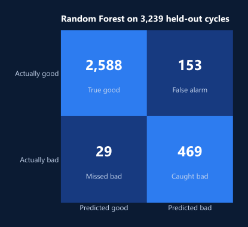

<div align="center">


</div>

Recycling aluminum scrap starts with decoating: heating the scrap to burn off paint, plastics and other coatings. A bad cycle leaves extra black dross, which is costly to dispose of and wastes metal. This project, built for the **CU Boulder DaSSA Hackathon**, classifies each cycle as good or bad from its sensor readings, so maintenance can step in early.

## Highlights

- **Catches 94% of bad cycles:** 469 of 498 bad cycles flagged on held-out data.
- **94.38% accuracy and 0.988 AUC** with a tuned Random Forest.
- **Built for imbalance.** Bad cycles are rare, so the training data is rebalanced with SMOTE, and tuning optimizes recall: a missed bad cycle costs far more than a false alarm.

## Results



| Metric (bad cycles) | Value |
| --- | ---: |
| Recall | 94.2% |
| Precision | 75.4% |
| F1 score | 0.84 |
| Overall accuracy | 94.38% |
| AUC-ROC | 0.988 |

## Data

- **16,504 training cycles**, recorded at 5-minute intervals from March to May 2020. Each row has 22 columns of furnace sensor readings and operating settings.
- A separate test set was scored for the competition; the predictions are in `results/test_predictions.csv`.

## Approach

1. **Clean:** impute missing values (mean for continuous columns, mode for categorical ones).
2. **Rebalance:** oversample the minority class with SMOTE.
3. **Compare models:** Logistic Regression, Random Forest and XGBoost.
4. **Tune:** GridSearchCV with 3-fold cross-validation, optimizing recall on bad cycles.
5. **Pick:** a Random Forest with the tuned settings.

## Repository

```
notebooks/decoating_cycle_classifier.ipynb   the full pipeline
notebooks/decoating_cycle_classifier.html    the notebook, rendered
results/test_predictions.csv                 predictions on the competition test set
assets/                                      chart and banner used in this README
```

## Run it

The notebook was written in Google Colab and reads the competition files from Drive (`/content/drive/MyDrive/Datasets/train_data.csv` and `test_data.csv`). Point those paths at your copies.

```
pip install -r requirements.txt
jupyter notebook notebooks/decoating_cycle_classifier.ipynb
```
